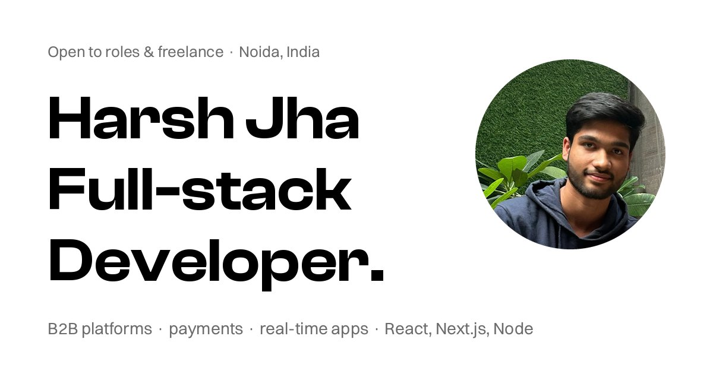

# Harsh Jha — Portfolio

Full-stack developer building B2B platforms, payment flows, real-time apps and the sites that sell them.

**Live:** [harsh-jha.vercel.app](https://harsh-jha.vercel.app/) · **Résumé:** [`/Harsh-Jha-Resume.pdf`](public/Harsh-Jha-Resume.pdf) · **LinkedIn:** [harsh-jha0047](https://www.linkedin.com/in/harsh-jha0047/) · **Email:** harshjha.00004@gmail.com



## What's inside

- **Work** — client and personal projects, filterable by type, year, category and stack, each with a case study (problem → what I built → outcome).
- **Shareable case studies** — every project has its own link, e.g. `/#work/gorevive`; the browser Back button closes it.
- **Experience, stack and contact** — the contact form posts to a form endpoint, or falls back to `mailto:`.

## Stack

React 19 · Vite 7 · Lenis (smooth scroll, disabled for reduced-motion users) · plain CSS + inline styles · no UI framework.

## Performance notes

- All logos are WebP/SVG at 2× their display size (the logo wall went from ~1.3 MB to ~75 KB).
- Hero fonts and the hero photo are preloaded.
- Hover effects are CSS-only, and the clock and rotating word are isolated components, so nothing re-renders the page on hover or on a timer.
- Project thumbnails: add a local `img: 'assets/shots/<id>.webp'` (~960×600) in `src/data/portfolio.js`. Projects without one fall back to a remote screenshot service, which is slower.

## Run locally

```bash
npm install
npm run dev       # http://localhost:5173
npm run build     # production build in dist/
```

## Configuration (`.env`)

| Variable | Purpose |
| --- | --- |
| `VITE_SITE_URL` | Your live URL (no trailing slash). Makes link previews on LinkedIn/Slack/WhatsApp work. |
| `VITE_CONTACT_ENDPOINT` | Optional form endpoint (e.g. Formspree). Without it, "Send brief" opens the visitor's mail app. |
